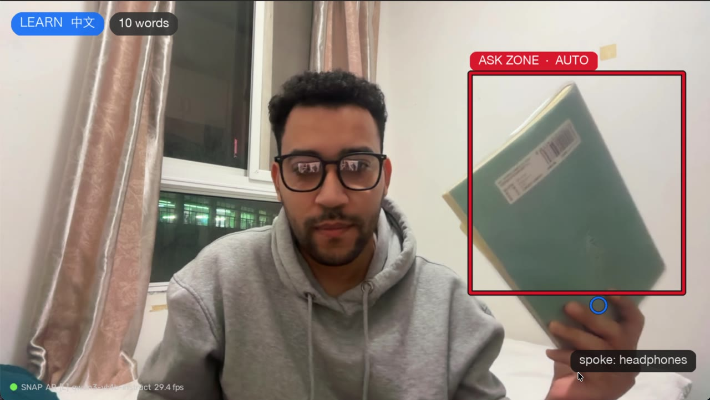
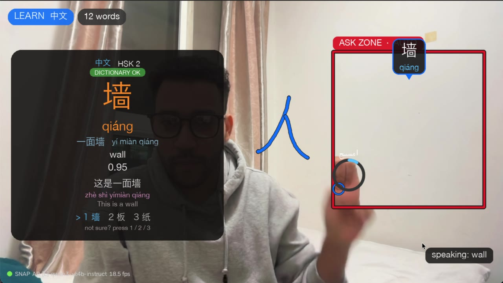
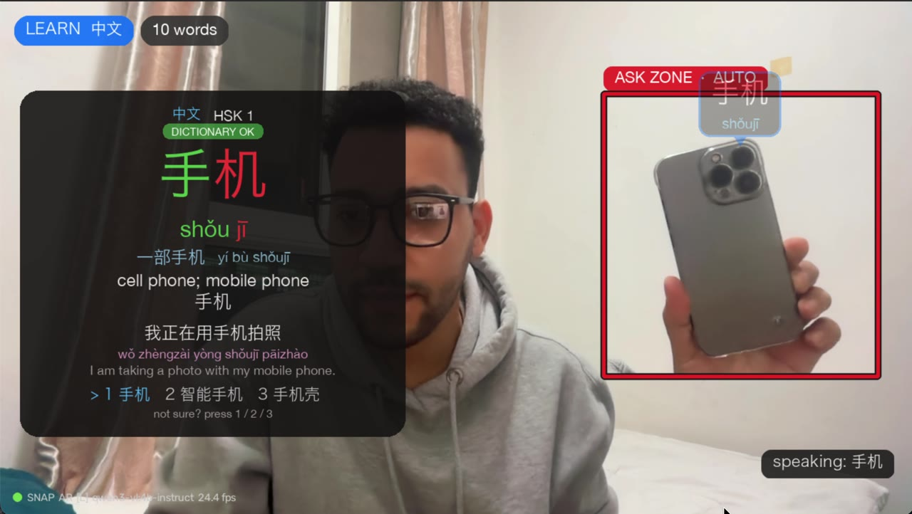

# AirMind ✍️🧠🇨🇳

**Learn Chinese from the real objects around you.** Hold anything up to your Mac's camera (or draw in the air with your finger, or just ask out loud) and a vision-language model running **entirely on your Mac** tells you what it is in Chinese: characters, pinyin with tones, meaning, measure word, HSK level and an example sentence, all spoken aloud.

> When you're a data scientist and Chinese is hard… you don't learn it. You build a model to teach you. 🤖🇨🇳

https://github.com/abdrhmnr/airmind/raw/main/docs/demo.mp4

| Hold it in the red box | Get a dictionary-checked word card |
|---|---|
|  |  |



- 🆓 Free and **offline** after the first download, with no cloud API and no account
- 🗣️ Interface in **Arabic** or **English**; teaches **Chinese** (or English)
- 🍎 Built for Apple Silicon Macs (macOS camera, `say`, Vision OCR)

---

## ✨ Features

| Feature | What it does |
|---|---|
| ✅ **Model names it, dictionary checks it** | Pinyin, tones and meaning come from **CC-CEDICT** (~120k entries, offline) + **pypinyin**, not from the model. Unknown words are flagged `NOT IN DICTIONARY`. |
| 🎯 **Top-3 candidates** | The model returns its 3 best guesses with confidence; AirMind picks the first one found in the dictionary. Not right? Press **1 / 2 / 3**. |
| 📇 **Full learning card** | Tone-colored characters, measure word (量词, e.g. 一**个**杯子), **HSK 3.0** level, and an example sentence with pinyin + translation. |
| 📒 **Notebook + Anki** | Every word is saved with **a photo of the real object** and its audio. **N** exports an Anki deck. |
| 🎮 **"Find it" game** (**H**) | AirMind says a word from your notebook; you hold up that object; the model checks. |
| 🗣️ **Pronunciation check** (**Y**) | Say the word; faster-whisper listens and compares you **syllable by syllable, tone by tone**. |
| 🧑‍🏫 **Voice tutor** (**V**) | Ask "how do I say *I want to buy this*?" and get a Chinese sentence + pinyin + meaning. |
| 📖 **Read mode + halal check** (**O**) | Point at a menu, label or sign: Apple Vision OCR reads it, the translation is painted over each line, and ingredients like 猪油 / 料酒 / 明胶 trigger a warning. |
| ✍️ **Air calligraphy** (**W**) | Write a Chinese character in the air with a brush: it's recognized, spoken and scored. |
| 🔁 **Interpreter** (**B**) | Speak Arabic/English → Chinese subtitles + voice, and back. |
| 📚 **Story karaoke** (**U**) | A short story built from the last words you learned, read aloud karaoke-style. |
| 🏷️ **Tracked stickers** | Labels stay on the objects as you move them (OpenCV CSRT). |
| ✋ **Auto-ask** (**A**) | Hold an object still in the red box and it asks by itself, without asking twice for the same thing. |
| ⚡ **Instant mode** (**I**, optional) | YOLO-World puts live Chinese labels on everything in view. |
| 📊 **Model benchmark** (`bench.py`) | Measures accuracy and speed of each local model on photos of *your* room. |

---

## 🏗️ How it works

```
camera ──► MediaPipe hands ──► gestures / air drawing
   │
   └──► sharpest frame of the last 0.5 s ──► local vision LLM (Ollama / LM Studio / llama-server)
                                                   │  top-3 names (JSON)
                                                   ▼
                              CC-CEDICT + pypinyin + HSK list  ──►  word card + macOS `say`
                                                   │
                                                   ▼
                                     SQLite notebook (photo + audio) ──► Anki
```

| File | Role |
|---|---|
| `airmind.py` | Main app: camera loop, modes, keys |
| `vlm.py` | Talks to the local vision model (Ollama / OpenAI-compatible), JSON schemas, retries |
| `chinese.py` | CC-CEDICT lookup, pinyin, tones, measure words, HSK |
| `hands.py` | Gesture reading, One-Euro smoothing, shape snapping |
| `capture.py` | Frame buffer, sharpest-frame pick, low-light enhancement, auto-capture |
| `tracker.py` | Stickers that follow objects |
| `ocr.py` | Apple Vision OCR for read mode |
| `hanzi.py` | Air-calligraphy recognition |
| `audio.py`, `speaker.py` | faster-whisper speech-to-text, `say` text-to-speech helper |
| `vocab.py` | Notebook (SQLite) + Anki export |
| `detector.py` | Optional YOLO-World instant labels |
| `ui.py` | Cards, stickers, Arabic/Chinese text rendering |
| `bench.py`, `selftest.py` | Model benchmark, installation self-test |

---

## 🚀 Setup

**Requirements:** Apple Silicon Mac (16 GB+ RAM recommended), Python 3.12/3.13, and [Ollama](https://ollama.com) (or LM Studio / llama.cpp).

```bash
git clone https://github.com/abdrhmnr/airmind.git
cd airmind
./setup.sh                 # creates .venv and installs everything, then runs selftest
# ./setup.sh instant       # also installs INSTANT mode (PyTorch + YOLO-World, ~1 GB)
# PIP_MIRROR=1 ./setup.sh  # use the Tsinghua PyPI mirror (faster from China)

ollama pull qwen3-vl:4b-instruct   # fast small vision model (use the -instruct one, not the "thinking" one)
```

The MediaPipe hand model is downloaded automatically on first run.

## ▶️ Run

```bash
FAST=1 ./start.sh --learn zh --auto     # small model via Ollama, English UI, learn Chinese
FAST=1 ./start.sh --lang ar --learn zh  # Arabic UI
OLLAMA_MODEL=qwen2.5vl:3b FAST=1 ./start.sh   # pick a specific model
./start.sh                              # bigger Gemma 4 26B through llama-server (smarter, slower)
```

## 🎮 Controls

**Hands:** pinch (thumb + index) = draw · thumbs up (hold) = ask · fist (hold) = clear · hold an object in the red box = auto-ask

**Keys:**

| Key | Action | Key | Action |
|---|---|---|---|
| `T` | learn words: 中文 → EN → off | `1/2/3` | pick another candidate |
| `O` | read text + halal check | `Y` | say it (pronunciation check) |
| `H` | "find it" game | `N` | notebook → Anki |
| `I` | instant labels | `A` | auto-ask on/off |
| `W` | air calligraphy | `V` | talk / tutor |
| `B` | interpreter | `U` | story karaoke |
| `SPACE` | ask | `C` | clear |
| `L` | Arabic / English | `F` | full screen |
| `R` / `S` | record / photo | `Q` | quit |

📘 Full Arabic user guide: [دليل_التشغيل.md](دليل_التشغيل.md)

---

## 📚 Data & credits

- **CC-CEDICT** dictionary by MDBG ([CC BY-SA 4.0](https://creativecommons.org/licenses/by-sa/4.0/)), see [`data/README.md`](data/README.md)
- **HSK 3.0** word lists from `@leonsilicon/hsk3.0`
- MediaPipe, OpenCV, pypinyin, faster-whisper, genanki, SymPy, Ollama, Qwen-VL, Gemma

## 📄 License

Code: [MIT](LICENSE). The bundled dictionary data keeps its own license (CC BY-SA 4.0).

---

Built by **Abdelrahman Habeeb** ([@abdrhmnrr01](https://instagram.com/abdrhmnrr01)), a data scientist in Wuhan who'd rather build a model than memorize flashcards.
